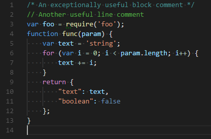

# Tema inspirado no Visual Studio Code para Notepad++

Este projeto apresenta uma proposta de tema para deixar a interface de edição do Notepad++ com uma aparência inspirada no Visual Studio Code. A imagem abaixo mostra a prévia disponível no repositório.

## Prévia

## Instalação

> **Importante:**  o repositório contém esta documentação e a imagem `screenshot.png`. há um arquivo de tema (`Visual Studio Code.xml`) para instalar. Para aplicar o tema, será necessário adicionar ou obter esse arquivo primeiro.

Quando baixar o arquivo `.xml` do tema em sua maquina, siga estes passos:

1. Feche o Notepad++.
2. Baixe o arquivo `.xml` do tema.
3. Copie o arquivo para a pasta de temas do Notepad++:
   - **Windows:** `%AppData%\Notepad++\themes\`
   - **Instalação portátil:** `<pasta do Notepad++>\themes\`
4. Abra o Notepad++ novamente.
5. Acesse **Configurações > Configurador de Estilo...** (*Settings > Style Configurator...*).
6. Na lista **Selecionar tema** (*Select theme*), escolha o tema e clique em **Salvar e Fechar** (*Save & Close*).

Se a pasta `themes` não existir, crie-a no local indicado. O tema só aparecerá na lista depois que o arquivo `.xml` correto estiver nessa pasta.

## Arquivos do repositório

- `screenshot.png` — imagem de prévia do tema.
- `README.md` — descrição e instruções de instalação.
